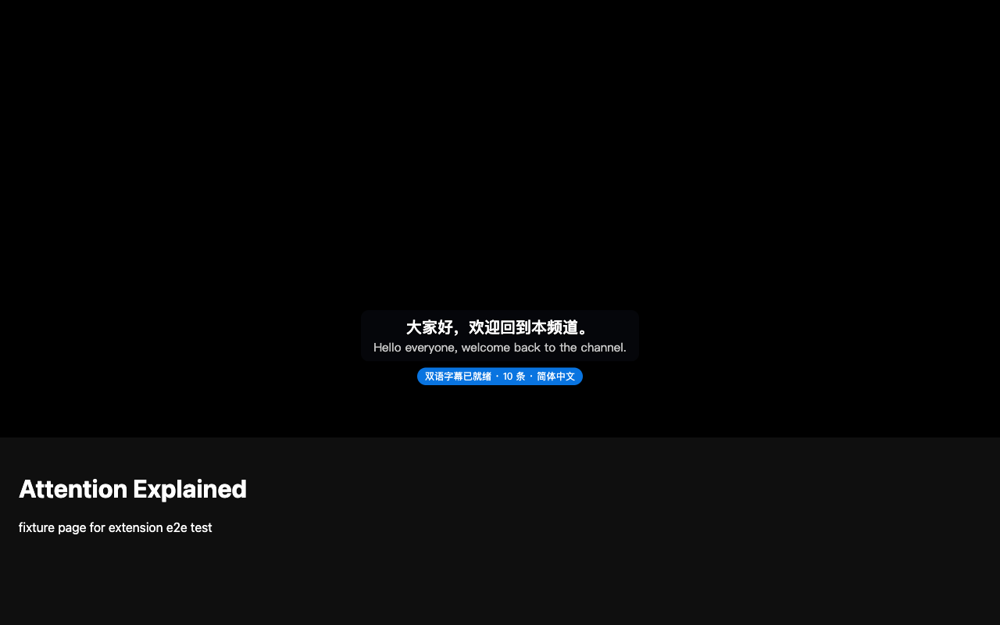
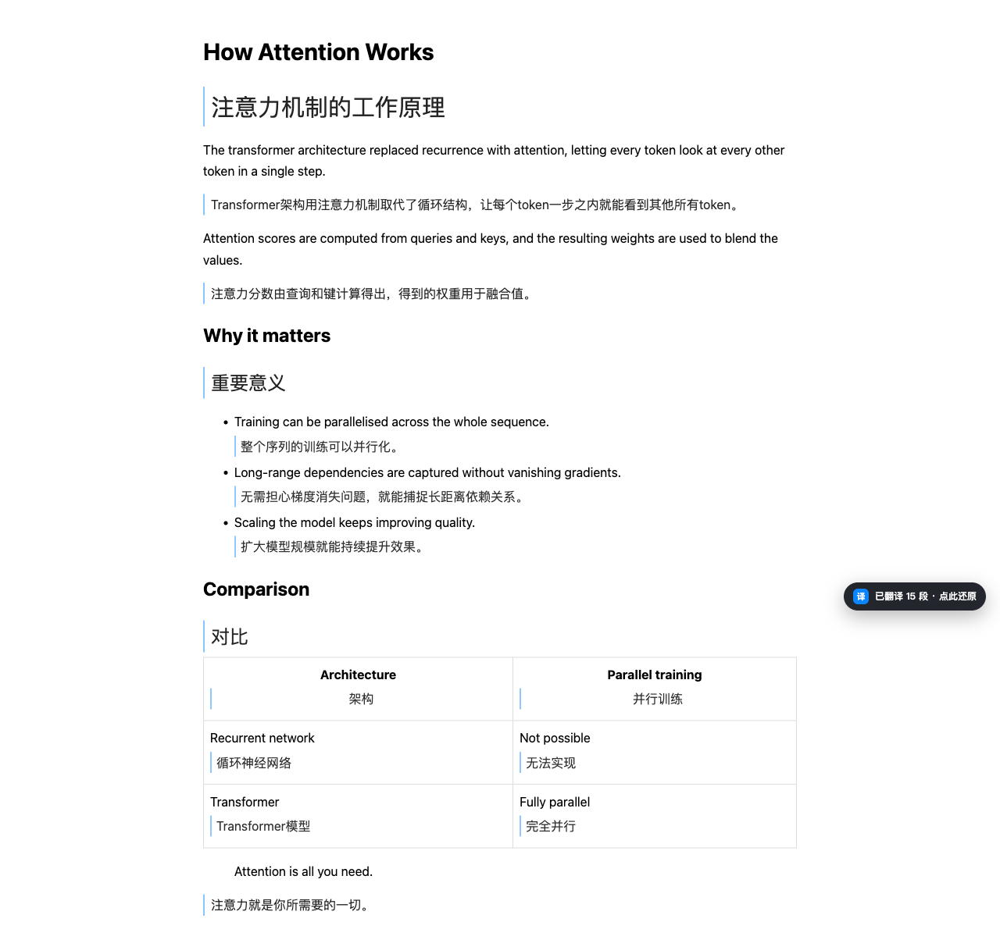

# LinguaLens

**A bilingual lens for the web.** A Chrome extension + hosted translation backend that turns YouTube videos into bilingual subtitles, exports bilingual SRT/VTT, and translates whole web pages in place.

- **Hosted backend:** https://lingualens.coze.site — install the extension and it just works, no local server, no API key.
- **Self-hostable:** the same Next.js backend runs locally (`bash ./scripts/dev.sh`).
- **Online updates:** the extension checks the backend for a newer release and links straight to the update.

[中文说明](README.zh-CN.md)

| YouTube bilingual subtitles | Whole-page translation |
| --- | --- |
|  |  |

## What it does

- **Bilingual subtitles on YouTube** — detects the video's caption track, translates it sentence by sentence, and renders the translation right under the original line, following playback.
- **Draggable subtitle box** — hold the `⠿` grip in the subtitle toolbar and move the box anywhere on the player. The position is remembered; double-click the grip to reset.
- **Download bilingual subtitles** — one click exports bilingual / translation-only / original-only subtitles as SRT or VTT, with correct timelines.
- **Whole-page translation** — on any web page press `Alt + A` (or use the popup) and LinguaLens translates the page paragraph by paragraph, inserting the translation under each original block. One click restores the original page.
- **Works when YouTube blocks captions** — four fallback strategies for caption retrieval, plus a manual import path: drop in any SRT/VTT and LinguaLens still translates and exports it.
- **No API key in the client** — translation goes through your own backend; the model token stays server-side.

## Architecture

```
Chrome MV3 extension  ──HTTP──▶  Next.js backend  ──▶  LLM (built-in token)
 content.js  (YouTube)           /api/translate
 page.js     (any site)          /api/youtube/timedtext
 background / popup / options    /api/health
 injected.js (page world)
```

| Path | Role |
| --- | --- |
| `src/app/api/translate/route.ts` | Batch translation endpoint (JSON array in, array out) |
| `src/app/api/youtube/timedtext/route.ts` | Server-side caption proxy fallback |
| `src/app/api/health/route.ts` | Health, model name, supported languages |
| `src/lib/translate.ts` | Batching (24 cues), concurrency (4), in-process cache, per-line fallback |
| `public/extension/content.js` | Subtitle overlay, playback sync, SRT/VTT export, drag |
| `public/extension/page.js` | Whole-page block collection, batching, insertion, restore |
| `scripts/build-extension.cjs` | Packages the extension into a zip |
| `tests/e2e-*.js` | Playwright end-to-end tests with a real Chromium + the loaded extension |

### Caption retrieval strategy

YouTube has tightened `timedtext` validation (PoToken + origin checks) since 2025, so the extension tries four routes in order and uses the first one that returns content:

1. `youtube.com/api/timedtext` from the background service worker (extension host permissions).
2. `fetch` from the page world (same-origin, carries page cookies).
3. Reuse a `pot=`-signed timedtext URL captured from the player's own network requests.
4. The official transcript panel endpoint (`youtubei/v1/get_transcript`).

If all four fail, the overlay says so and you can import a local subtitle file instead.

## Quick start

### 1. Use the hosted backend (default)

Nothing to install. The extension ships with `https://lingualens.coze.site` as its default backend, so it works on any network right after loading.

### 1b. Or run your own backend

```bash
bash ./scripts/prepare.sh   # install dependencies (first run only)
bash ./scripts/dev.sh       # dev server on http://localhost:5050
```

> Port 5050 by default, because macOS AirPlay Receiver occupies 5000. Override with `PORT=6000 bash ./scripts/dev.sh` and update the extension's backend URL accordingly.

Verify:

```bash
curl -s http://localhost:5050/api/health
curl -s -X POST http://localhost:5050/api/translate \
  -H 'Content-Type: application/json' \
  -d '{"texts":["Attention is all you need."],"targetLang":"zh-CN"}'
```

### 2. Install the extension

1. Unzip `public/lingualens-v2.1.1.zip` into a permanent folder.
2. Open `chrome://extensions` and enable **Developer mode**.
3. Click **Load unpacked** and pick the unzipped folder (it must contain `manifest.json`).
4. Open any YouTube video — the subtitle overlay appears on the player.

Chrome will ask for permission to read data on all websites; that permission is what makes whole-page translation possible. All translation goes through the backend (hosted by default, or your own).

## Online updates

| Path | What it is |
| --- | --- |
| Popup / options → **检查更新** | Compares the installed version with `GET /api/extension/latest` and shows the changelog + a download link |
| `GET /updates.xml` | Chrome update manifest (`update_url` in `manifest.json`), pinned to extension id `megljaakikpaegbfnfdkphmpkapdonec` |
| `GET /lingualens.crx` | Signed package (`scripts/pack-crx.sh`, key in `.keys/`, never committed) |

How far the automation goes depends on how the extension was installed:

- **`.crx` install / enterprise policy** — Chrome polls `updates.xml` and upgrades silently.
- **Unpacked install** — Chrome never auto-updates unpacked extensions; use **检查更新**, then reload the new folder.
- **Chrome Web Store** — the only way to get silent updates for ordinary users. The `public/lingualens-v2.1.1.zip` is store-ready (MV3, no remote code, no `default_locale`).

Server-side changes (model, prompt, rate limits) need no client update at all — they ship with the backend.

### Chrome Web Store package

Everything needed to publish is in [`store/`](store/README.md): listing copy (zh/en), permission justifications, privacy policy, five 1280×800 screenshots and the promo tiles.

```bash
node scripts/build-store-package.cjs   # -> store/lingualens-v2.1.1-store.zip (update_url stripped)
```

Privacy policy (live): <https://lingualens.coze.site/privacy>

## Usage

| Action | How |
| --- | --- |
| Translate subtitles | Open a YouTube video; translation starts automatically |
| Move the subtitle box | Hold the `⠿` grip in the toolbar and drag; double-click to reset |
| Toggle subtitles | Overlay toggle or `Alt + T` |
| Download subtitles | Overlay button, `Alt + D`, or the popup panel (bilingual / translation / original × SRT / VTT) |
| Whole-page translation | `Alt + A`, the floating `译` pill, or popup → 翻译本页 |
| Restore the page | Popup → 恢复原文, or click the pill again |
| Change target language | Popup → target language (14 languages) |
| Import local subtitles | Popup → import local subtitle file (SRT / VTT) |
| Tune appearance | Options page: font size, bottom offset, hide native captions, show original, reset position |

## API

| Method | Endpoint | Description |
| --- | --- | --- |
| `GET` | `/api/health` | Status, model, languages, uptime |
| `POST` | `/api/translate` | `{ texts: string[], targetLang?: string }` → `{ translations: string[] }` |
| `GET` | `/api/youtube/timedtext` | Caption proxy: `?url=<timedtext url>` or `?v=<videoId>&lang=<code>` |
| `GET` | `/api/extension/latest` | Latest extension version, zip/crx URLs, changelog |
| `GET` | `/updates.xml` | Chrome extension update manifest |

## Tests

```bash
pnpm ts-check && pnpm lint:build && pnpm lint:style
node tests/e2e-extension.js   # 14 assertions: rendering, shortcuts, SRT/VTT export, update check
node tests/e2e-import.js      # 8 assertions: manual subtitle import path
node tests/e2e-v2.js          # 16 assertions: drag & persist, whole-page translation, restore

The E2E scripts pin `backendUrl` to the local dev server so they never depend on the hosted deployment.
```

The E2E scripts drive a real Chromium with the extension loaded and fake pages (`tests/fixtures/`), so they don't depend on YouTube's anti-bot behaviour.

## Known limitations

- YouTube caption availability depends on your network. From datacenter IPs, YouTube often returns `is_servable: false` and empty caption bodies; use a normal home network, or the manual import path.
- Whole-page translation only covers text blocks (`p`, `li`, headings, table cells, quotes, captions). Canvas, images, and shadow-DOM widgets are skipped.
- Long videos (500+ cues) take tens of seconds on first translation; cues appear progressively.
- The translation cache is in-process, so it is cleared when the backend restarts.
- Unpacked extensions cannot be auto-updated by Chrome; silent updates need the Web Store or a managed `.crx` install.

## License

MIT
