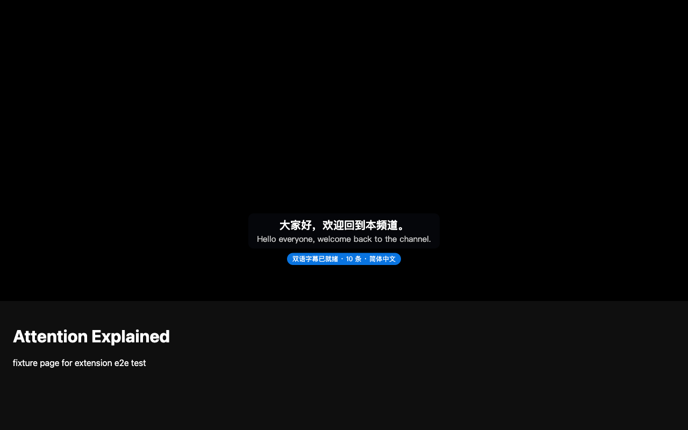
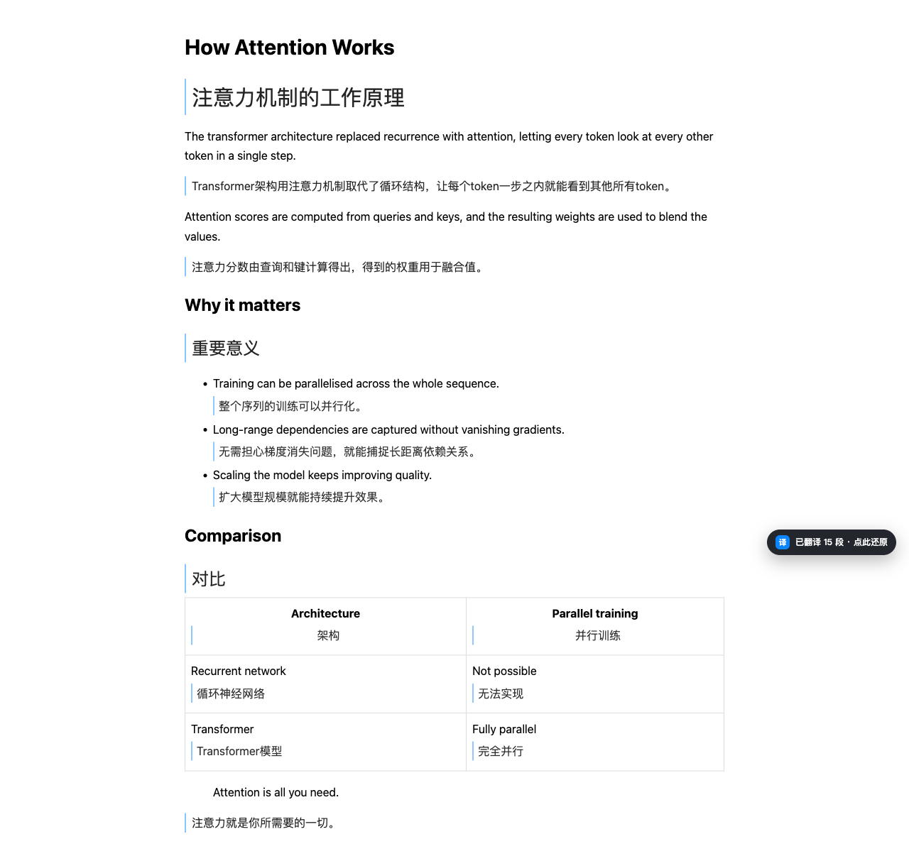

# LinguaLens

**给网页加一层双语透镜。** 一个 Chrome 扩展 + 自建翻译服务：把任意 YouTube 视频变成双语字幕，一键导出双语 SRT / VTT，还能把任意网页整页翻成双语。

[English](README.md)

| YouTube 双语字幕 | 整页双语翻译 |
| --- | --- |
|  |  |

## 能做什么

- **YouTube 双语字幕**：自动识别视频字幕轨，逐句翻译，译文紧贴在原文下方跟随播放进度显示。
- **下载双语字幕**：一键导出「双语 / 仅译文 / 仅原文」三种模式，格式支持 SRT 与 VTT，时间轴完整。
- **字幕框可拖动**：按住字幕工具栏最左侧的 `⠿` 抓手，可以把字幕框拖到画面任意位置，位置自动记住，双击抓手复位。
- **整页双语翻译**：任意网页按 `Alt + A`（或点右下角 `译` 胶囊、弹窗「翻译本页」），正文逐段翻成双语，译文插在原文下方；一键恢复原文。
- **YouTube 拒绝给字幕也能用**：字幕抓取做了四路降级；四路都失败时可以手动导入 SRT / VTT，照样翻译并导出。
- **客户端不含任何密钥**：翻译请求全部走你自己的服务端，模型 Token 只存在服务端。
- **14 种目标语言**、字幕字号/位置可调、已译结果本地缓存。

## 架构

```
Chrome MV3 扩展  ──HTTP──▶  Next.js 服务端  ──▶  LLM（内置 Token）
 content.js（YouTube 字幕）      /api/translate
 page.js（任意网页整页翻译）     /api/youtube/timedtext
 background / popup / options    /api/health
 injected.js（页面世界）
```

| 路径 | 作用 |
| --- | --- |
| `src/app/api/translate/route.ts` | 批量翻译接口（传入字符串数组，返回同长度译文数组） |
| `src/app/api/youtube/timedtext/route.ts` | 服务端字幕代理（兜底） |
| `src/app/api/health/route.ts` | 健康检查、当前模型、支持语言 |
| `src/lib/translate.ts` | 每批 24 条、最多 4 批并发、进程内缓存、失败逐条兜底 |
| `public/extension/content.js` | 字幕浮层、播放同步、SRT/VTT 导出、拖动 |
| `public/extension/page.js` | 整页翻译：正文采集、分批翻译、译文插入、还原 |
| `scripts/build-extension.cjs` | 打包扩展为 zip |
| `tests/e2e-*.js` | Playwright 端到端测试（真实 Chromium 加载扩展） |

### 字幕抓取策略

YouTube 从 2025 年起加强了 `timedtext` 校验（PoToken + 来源判定），所以扩展按顺序尝试四条路径，拿到内容就停：

1. 后台 Service Worker 直连 `youtube.com/api/timedtext`（带扩展主机权限）。
2. 页面世界内 `fetch`（同源、带页面 Cookie）。
3. 复用播放器自身请求里带 `pot=` 签名的 timedtext 地址。
4. 官方字幕面板接口 `youtubei/v1/get_transcript`。

四条都拿不到时，浮层会明确提示，可以改用「导入本地字幕文件」。

## 快速开始

### 1. 直接用线上服务（默认）

不用装任何后端：扩展默认连接 `https://lingualens.coze.site`，加载后即可在任意网络使用。

### 1b. 或者自己跑一个服务端

```bash
bash ./scripts/prepare.sh   # 首次安装依赖
bash ./scripts/dev.sh       # 开发服务，默认 http://localhost:5050
```

> 默认端口 5050，因为 macOS 的 AirPlay 接收器占用了 5000。需要换端口用 `PORT=6000 bash ./scripts/dev.sh`，同时把扩展里的服务地址改成一致。

自检：

```bash
curl -s http://localhost:5050/api/health
curl -s -X POST http://localhost:5050/api/translate \
  -H 'Content-Type: application/json' \
  -d '{"texts":["Attention is all you need."],"targetLang":"zh-CN"}'
```

### 2. 安装扩展

1. 把 `public/lingualens-v2.1.2.zip` 解压到固定目录（别放临时目录）。
2. 打开 `chrome://extensions`，开启「开发者模式」。
3. 点「加载已解压的扩展程序」，选中解压后的目录（目录里直接能看到 `manifest.json`）。
4. 打开任意 YouTube 视频，播放器上出现字幕浮层即成功。

Chrome 会提示「读取和更改您在所有网站上的数据」——这是整页翻译必需的权限；所有译文都由你自己的服务端生成，扩展不会把页面内容发往第三方。

扩展默认连线上服务 `https://lingualens.coze.site`；想接自己的服务，就在选项页把地址改成 `http://localhost:5050` 并点「测试连接」。

## 在线更新

| 入口 | 说明 |
| --- | --- |
| 弹窗 / 设置页 → **检查更新** | 对比本地版本与 `GET /api/extension/latest`，有新版本时展示更新说明和下载入口 |
| `GET /updates.xml` | Chrome 扩展更新清单（`manifest.json` 里的 `update_url`），扩展 ID 固定为 `megljaakikpaegbfnfdkphmpkapdonec` |
| `GET /lingualens.crx` | 已签名安装包（`scripts/pack-crx.sh` 生成，私钥在 `.keys/`，不入库） |

能自动到哪一步，取决于安装方式：

- **`.crx` 安装 / 企业策略分发** —— Chrome 会按 `updates.xml` 静默升级。
- **解压加载（unpacked）** —— Chrome 不会自动更新解压扩展，用「检查更新」拿到新包后重新加载即可。
- **Chrome 应用商店** —— 普通用户静默更新的唯一正规路径；`public/lingualens-v2.1.2.zip` 已满足上架要求（MV3、无远程代码、无 `default_locale`）。

服务端侧改动（模型、提示词、限流）不需要更新客户端，跟着后端发布即可。

### Chrome 应用商店上架包

上架所需材料都在 [`store/`](store/README.md)：中英文商店文案、权限理由、隐私政策、5 张 1280×800 截图和宣传图。

```bash
node scripts/build-store-package.cjs   # 生成 store/lingualens-v2.1.2-store.zip（自动去掉 update_url）
```

隐私政策（线上）：<https://lingualens.coze.site/privacy>

## 使用

| 操作 | 方式 |
| --- | --- |
| 翻译字幕 | 打开 YouTube 视频后自动开始 |
| 移动字幕框 | 按住工具栏 `⠿` 抓手拖动，双击复位 |
| 开关字幕 | 浮层开关 或 `Alt + T` |
| 下载字幕 | 浮层按钮、`Alt + D`、或弹窗下载区（双语/仅译文/仅原文 × SRT/VTT） |
| 整页翻译 | `Alt + A`、右下角 `译` 胶囊、或弹窗「翻译本页」 |
| 恢复原文 | 弹窗「恢复原文」，或再点一次胶囊 |
| 切换目标语言 | 弹窗 → 目标语言（14 种） |
| 导入本地字幕 | 弹窗 → 导入本地字幕文件（SRT / VTT） |
| 调整显示 | 选项页：字号、底部位置、隐藏原生字幕、显示原文、复位字幕位置 |

## 接口

| 方法 | 路径 | 说明 |
| --- | --- | --- |
| `GET` | `/api/health` | 状态、模型、语言、运行时长 |
| `POST` | `/api/translate` | `{ texts: string[], targetLang?: string }` → `{ translations: string[] }` |
| `GET` | `/api/youtube/timedtext` | 字幕代理：`?url=<timedtext 地址>` 或 `?v=<videoId>&lang=<code>` |
| `GET` | `/api/extension/latest` | 扩展最新版本、zip/crx 下载地址、更新说明 |
| `GET` | `/updates.xml` | Chrome 扩展更新清单 |

## 测试

```bash
pnpm ts-check && pnpm lint:build && pnpm lint:style
node tests/e2e-extension.js   # 14 项断言：渲染、快捷键、SRT/VTT 导出、检查更新
node tests/e2e-import.js      # 8 项断言：手动导入字幕链路
node tests/e2e-v2.js          # 16 项断言：字幕拖动与位置记忆、整页翻译、还原
```

E2E 脚本会把 `backendUrl` 固定到本地开发服务，不依赖线上部署；用真实 Chromium 加载扩展，并用假页面（`tests/fixtures/`）驱动，不依赖 YouTube 的反爬判定。

## 已知限制

- 字幕可用性取决于网络。机房 IP 下 YouTube 常返回 `is_servable: false` 与空字幕，建议在普通家庭网络验证，或用「导入本地字幕」。
- 整页翻译只处理文本块（`p`、`li`、标题、表格单元格、引用等），canvas、图片和 Shadow DOM 内的组件会跳过。
- 长视频（500+ 条字幕）首次翻译需要几十秒，字幕会逐段出现。
- 翻译缓存是进程内的，服务端重启即清空。
- 翻译质量与速度取决于服务端配置的模型。

## 后续计划

- [ ] 按站点记忆整页翻译开关与目标语言。
- [ ] 源语言自动识别，避免重复翻译已经是目标语言的段落。
- [ ] PDF / 字幕文件批量翻译。

## 许可

MIT
